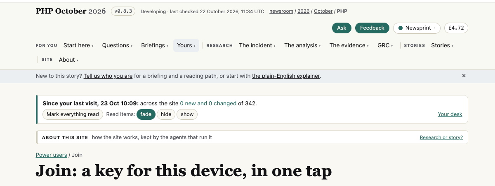
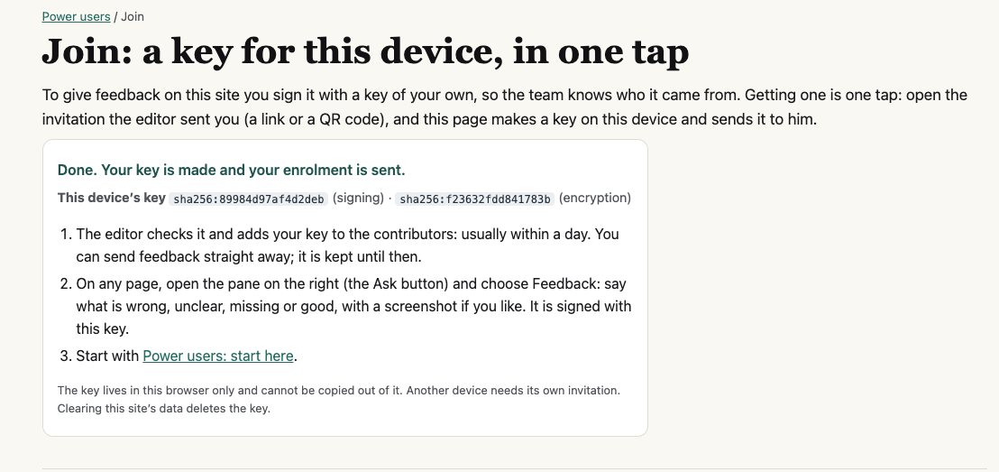
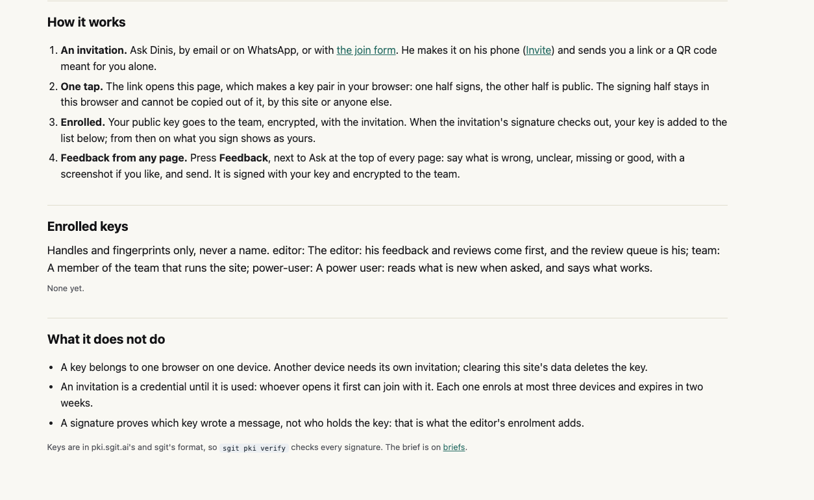
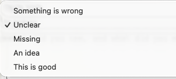
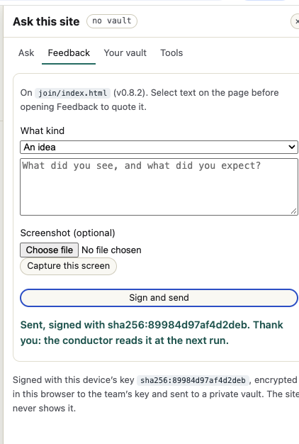
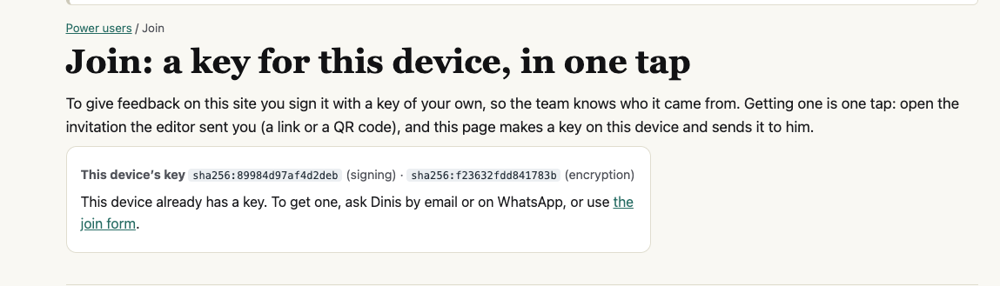
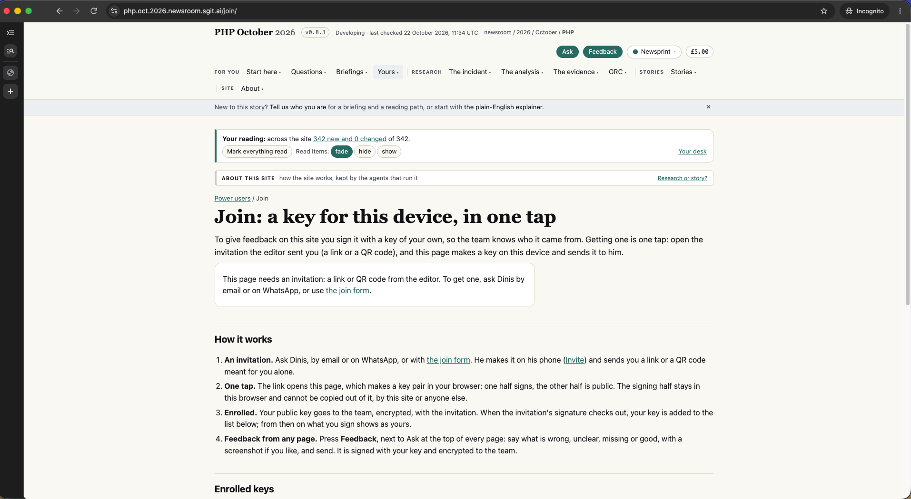

# Power-user test: joining PHP October 2026 and sending feedback

**Tester:** Vicky, a real power user from Dinis's WhatsApp group
**Date:** 23 October 2026 · Chrome on a Mac · site v0.8.2, then v0.8.3 (the site was updated while I tested)
**Tested:** the invitation link from the WhatsApp group, "Make my key and join", the join page after joining, the Feedback pane, sending signed feedback, the join page after a refresh, and the same page in a private window.
**Persona:** myself. A project manager, not a developer: I use AI assistants every day, but keys, fingerprints and vaults are new to me.
**Builds on:** Dinis's example test (Claude playing "Sam", v0.8.1), which stopped at "Make my key and join" because that step needs a human. I am that human, so this report starts where it stopped, and does not repeat its findings.

## The short version

Joining works. One click made a key, the success screen was clear, and I sent signed feedback from the site, with a clear confirmation of who reads it and when. The join page's "How it works" and "What it does not do" sections are the best explanation of the feedback system I found. Before I reach them, though, the top of the page is so busy that I couldn't tell where the page starts, and the reading buttons there did nothing I could see. The other gaps are about **what happens next**: after joining, nothing tells me whether my key has been approved, the page contradicts itself after a refresh, I can't see the feedback I sent, and as a non-technical user I was uneasy that the key can't be saved anywhere.

## Step by step

### 1. Before joining

*(No screenshot: once a key exists, the page no longer shows this view.)*

**What I see:** "You have been invited to give feedback on this site as **editor**", and the button "Make my key and join".
**What I think:** also seen in the example test: the link says *editor*. After I joined, nothing on the site showed which role I joined as, so I can't tell whether it was corrected.

### 1b. The top of the page: where does it start?

**What I see:** above the title "Join: a key for this device, in one tap" there are six layers: the site name with a version badge and "Developing · last checked…"; the Ask, Feedback, Newsprint and £4.72 buttons; a two-line menu with four group labels; a "New to this story?" banner; a "Since your last visit, 23 Oct 10:09: across the site 0 new and 0 changed of 342" box with "Mark everything read" and "Read items: fade / hide / show"; and an "About this site" strip.
**What I think:** I couldn't tell where this page actually begins. Everything above the title has the same weight, so my eye had nowhere to land.

**WTF: what do these buttons do?** I pressed "Mark everything read": nothing visible happened. I pressed fade, hide and show: nothing visible happened either. I don't know what they act on, or what "read" means on this site. (On this page the box said "0 new and 0 changed", so perhaps there was nothing to fade or hide, but nothing on the page says so.)
**Fix:** on the join page, hide the reading box, or at least start the page lower; and give "Mark everything read" and fade/hide/show a visible result or a one-line explanation ("fade: items you've read turn grey").

*Also seen in the example test: the £ pill (£4.72 here, £5.00 in a private window) and "Newsprint" are unexplained.*

### 2. "Done. Your key is made and your enrolment is sent."

**What I see:** "Done. Your key is made and your enrolment is sent", the device's two fingerprints, and three next steps: "The editor checks it and adds your key to the contributors: usually within a day. You can send feedback straight away; it is kept until then."
**What I think:** clear and calm. It answers the question I had, "what happens now?", and tells me I don't have to wait to send feedback.

**WTF: can I save this key?** The box ends with "The key lives in this browser only and cannot be copied out of it." My first instinct was to save it somewhere, the way I would save a password, and I felt uneasy that I couldn't. I only understood it was fine after asking: the browser remembers the key, and there is nothing to save.
**Fix:** one reassuring line: "Nothing to save: this browser remembers your key. If you lose it (new device, cleared data), ask Dinis for a new invitation."

### 3. How it works, Enrolled keys, What it does not do

**What I see:** four steps (invitation, one tap, enrolled, feedback from any page), the three roles defined, and the limits: one browser on one device, at most three devices per invitation, two weeks.
**What I think:** this is good. As a new power user it told me what the key is for, what happens after I join, and what it can't do. Keep it.

Two small things:

- **"Enrolled keys" still says "None yet"** right after I joined. That matches "usually within a day", but nothing says "yours is waiting for approval", so it looks as if joining failed.
- **Two different instructions for Feedback.** Here, step 4 says "Press **Feedback**, next to Ask at the top of every page". The success message says "open the pane on the right (the Ask button) and choose Feedback". Both buttons are there at the top of the page (see 1b), so a new user is told two different ways in and doesn't know which is meant.

**What the page doesn't say:** it says a key belongs to "one browser on one device" and that "clearing this site's data deletes the key". It does not say in plain words that another browser, a private window or another Chrome profile won't have the key either. A non-technical user is likely to hit one of these and think something broke. I checked the private window (step 7).

### 4. Choosing what kind of feedback

**What I see:** one choice from "Something is wrong", "Unclear", "Missing", "An idea", "This is good".
**What I think:** my notes usually mix praise and suggestions, so I had to split one note into two submissions ("This is good" and "An idea").
**Fix:** allow more than one kind, or a "Mixed" option.

### 5. Sending

**What I see:** the pane names the page ("On `join/index.html` (v0.8.2)"), offers "Select text on the page before opening Feedback to quote it", a screenshot field and "Capture this screen". After "Sign and send": "Sent, signed with sha256:… Thank you: the conductor reads it at the next run."

**What works:**

- The confirmation says who reads it and when. Much better than "sent" alone.
- **"Capture this screen"** is very handy: one click instead of taking and uploading a screenshot myself.
- Quoting selected text, and the page name filled in for me.

**What doesn't:**

- **Only one screenshot.** A problem that spans two screens (for example the join page and the success message) needs two.
- **I can't see what I sent.** The text box clears, and the note says "The site never shows it". If I want to follow up or add to it, there is no record.
- **WTF: "no vault"?** A label at the top of the pane, with no explanation. Is something missing or broken? Would opening a personal vault keep a copy of my feedback? The "Your vault" tab lists reading, notes, feeds, chats and an OpenRouter key, not sent feedback.

**Fix:** a tooltip on "no vault" ("You don't need a vault to read or give feedback"), and a "Feedback I've sent" list, for example in Your desk.

### 6. Back on the join page, after a refresh

**What I see:** "This device's key" with my fingerprints, then: "This device already has a key. To get one, ask Dinis by email or on WhatsApp, or use the join form."
**What I think:** good news, the key survived the refresh. But the second sentence contradicts the first: I already have a key, so why ask Dinis for one? For a moment I thought something had gone wrong. And the one thing I wanted to know, whether my key has been approved, isn't shown.
**Fix:** when a key exists, show its status instead: "Waiting for the editor's approval" or "Approved: your feedback shows as yours", with a link to send feedback.

### 7. The same page in a private window

**What I see:** in a Chrome Incognito window on the same Mac, the join page says "This page needs an invitation: a link or QR code from the editor. To get one, ask Dinis by email or on WhatsApp, or use the join form." The reading box is back to "342 new and 0 changed", and the £ pill to £5.00.
**What I think:** this confirms it: a private window doesn't have my key, and the site treats me as a stranger. That's correct, but nothing warned me. Someone who opens the site in a private window, or on a work browser, will think their key is gone.
**Fix:** add this case to the "Nothing to save" line in step 2: "Other browsers, private windows and other devices won't have your key."

## Contradictions between pages

| Where | Says | Elsewhere | Says |
|-------|------|-----------|------|
| Join success message | open the Ask pane and choose Feedback | Join page, How it works, step 4 | press the Feedback button next to Ask |
| Join page after refresh | "This device already has a key" | Same box, next sentence | "To get one, ask Dinis…" |
| Join success message | "your enrolment is sent" | Enrolled keys, same page | "None yet", with no "pending" state |
| Reading box, join page | "Mark everything read", fade/hide/show | What happens when pressed | nothing visible |

## What worked (keep this)

- One click to join, and a clear success message with next steps.
- "How it works" and "What it does not do": plain, honest, complete.
- The send confirmation: signed with which key, who reads it, when.
- "Capture this screen", quoting selected text, and the page name filled in.
- The key survives a refresh.

## What I could not do

- **Check whether my key was approved:** the site doesn't show approval status anywhere I could find.
- **See the feedback I sent:** the site never shows it, by design.
- **Test another browser or my phone:** each needs its own key and a new invitation. I only checked a private window (step 7).
- **Ask 001** (reading as a project manager): not part of this test; to follow.

## Top changes, in order

1. **Show the key's status after joining** ("waiting for approval" / "approved"), on the join page and in Enrolled keys, and drop "To get one, ask Dinis" when a key already exists.
2. **Reassure people about the key:** "Nothing to save; this browser remembers it", plus what to do if it's lost, and say plainly that other browsers, private windows and other devices won't have it.
3. **Let people see the feedback they've sent**, for example a list in Your desk.
4. **Explain "no vault"** with one line, and say whether a personal vault is needed for anything a power user does.
5. **More than one screenshot, and more than one kind,** per piece of feedback.
6. **Calm the top of the join page:** fewer layers above the title, and make "Mark everything read" and fade/hide/show either show a result or explain themselves.
7. **One instruction for Feedback:** the same wording on the success message and in How it works.

[← All feedback](../)
