# Power-user test: PHP October 2026, reading as a project manager (Ask 001)

**Tester:** Vicky, as a power user (reader: Project or programme manager)

**Date:** 23 October 2026 · MacBook Air, Chrome · site v0.8.4

**Tested:** Power users: start here → front page → Start here (the reader map) → Taylor's reading path, steps 1 to 5 → fact-check desk → team page. The join flow and signed feedback are reported separately: [Joining and sending feedback](../2026-10-23-php-newsroom-join-test/).

**Persona:** non-technical newcomer; knows AI assistants, not keys or vaults; about 75 minutes (estimated from screenshot times).

## The short version

The biggest problem is repetition: the same point is often made two or three times on one page, and simple things are explained in complicated words, so I kept losing track of what mattered. The most useful parts of the site, "The answer in thirty seconds" and "How to read this site", only made sense to me at the end, because nothing tells you what they are when you first meet them. What worked best was the reader map, the definitions that appear when you hover over a word, the "As of…" time on "Right now", and the fact that every sentence links to its source. Taylor's reading path answered most of Taylor's question, but not "what do I tell stakeholders". I did not get to Now on my phone.

## Step by step

### 1. Power users: start here

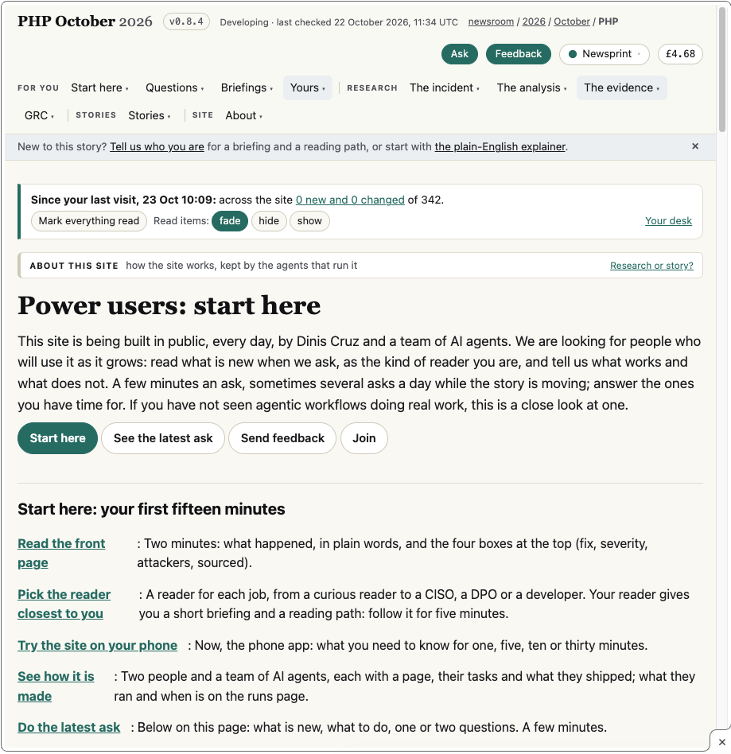

**What I see:** "Power users: start here", then "Start here: your first fifteen minutes", starting with "Read the front page: Two minutes: what happened, in plain words, and the four boxes at the top (fix, severity, attackers, sourced)."

**What I think:** This list is detailed and easy to follow. I started with "Read the front page".

### 2. Front page: the header

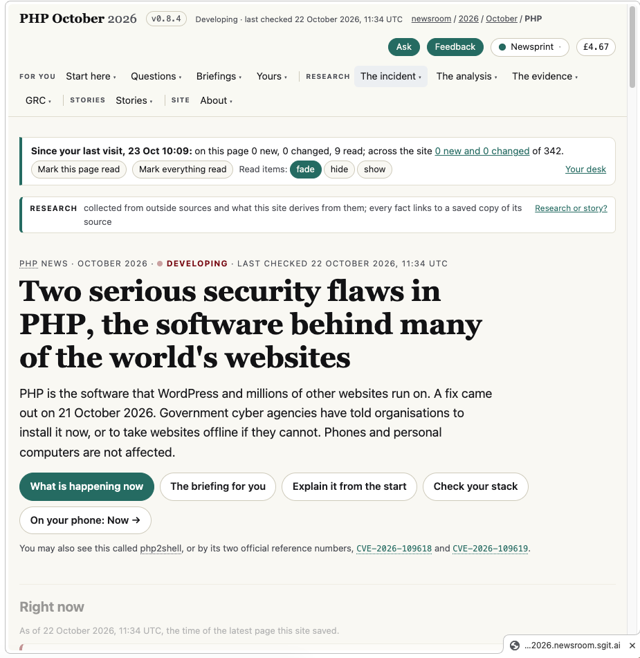

**What I see:** Above the title: "FOR YOU", "Start here", "Questions", "Briefings", "Yours", "RESEARCH", "The incident"… then "Since your last visit, 23 Oct 10:09: on this page 0 new, 0 changed, 9 read", "Read items: fade hide show". Next to the title: "DEVELOPING" in red, with a flashing dot.

**What I think:** There is too much above the title; I can't tell what I need to know and what I can ignore. The menu labels confused me a lot.

**WTF:** What does the red, flashing "DEVELOPING" mean? Is the page unfinished? Can I trust what it says? Hovering over it explains nothing.

**Fix:** Put a one-line explanation on "DEVELOPING" (hover or tap), and say "faded = already read" next to the fade control.

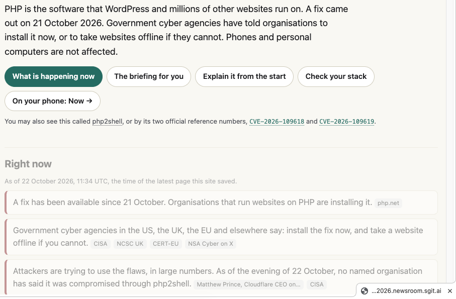

**WTF:** When the page opened, the top was solid and everything below looked greyed out. Is it not working yet, or being edited? It turns solid when I hover. (It seems "Read items: fade" fades things marked as read, but nothing tells you that.)

Also seen in the reference test: the price pill (here "£4.67"; it was "£4.68" on the previous page). I thought it meant I had to pay.

### 3. Front page: "Right now"

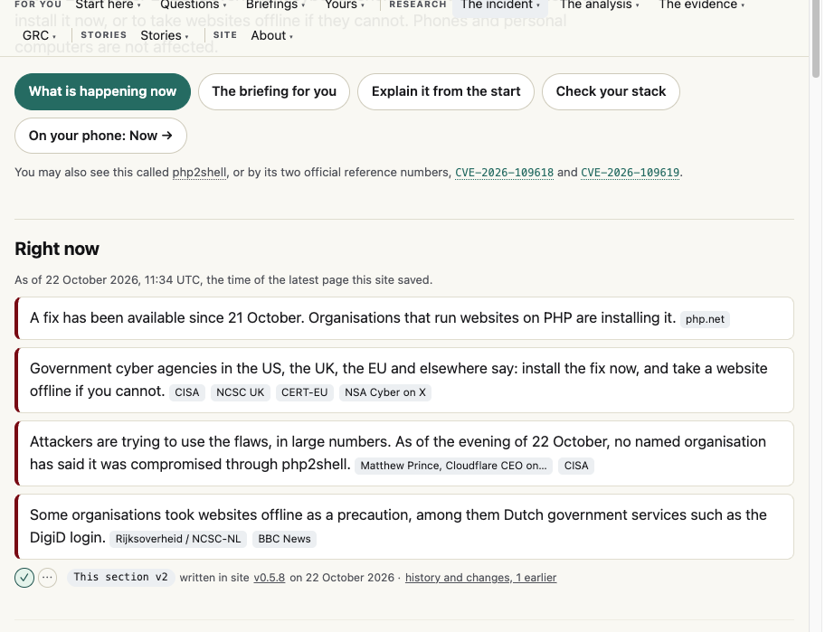

**What I see:** Five buttons under the summary ("What is happening now", "The briefing for you", "Explain it from the start", "Check your stack", "On your phone: Now"). Then "Right now", "As of 22 October 2026, 11:34 UTC, the time of the latest page this site saved.", and four short points, each with source tags (php.net, CISA, NCSC UK…).

**What I think:** The "As of…" line is very good: I know how fresh the news is. The four points are short and clear. The source tags open pages on this site, but those pages were hard for me to understand.

### 4. Start here: the reader map

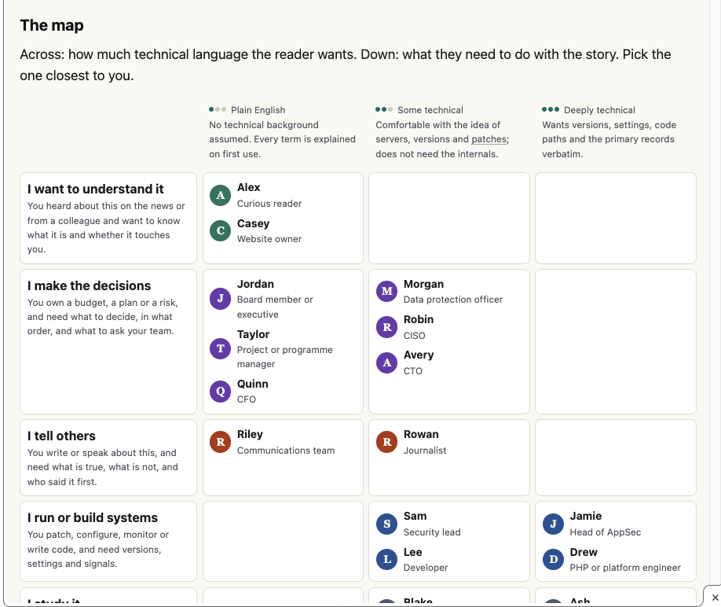

**What I see:** "Across: how much technical language the reader wants. Down: what they need to do with the story. Pick the one closest to you."

**What I think:** Very well organised. The rows and columns are explained, so it was easy to pick Taylor.

### 5. Taylor's card

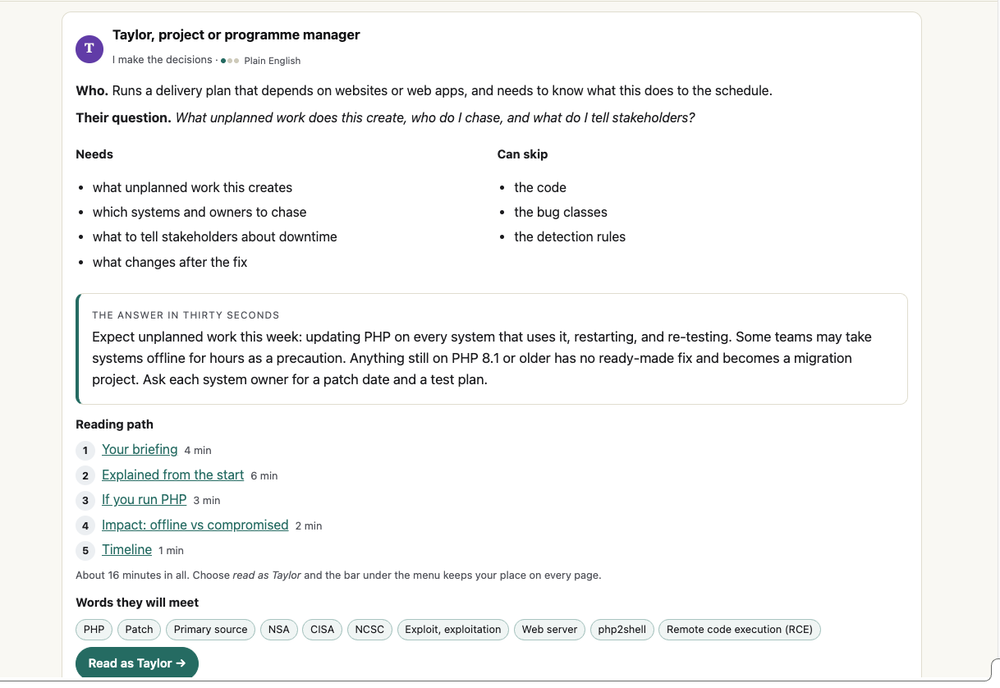

**What I see:** "Their question. *What unplanned work does this create, who do I chase, and what do I tell stakeholders?*", "Needs" and "Can skip", "THE ANSWER IN THIRTY SECONDS", "Reading path" with minutes per page ("About 16 minutes in all."), and "Words they will meet".

**WTF:** Is "Their question" the question Taylor has in mind while reading? The card doesn't say.

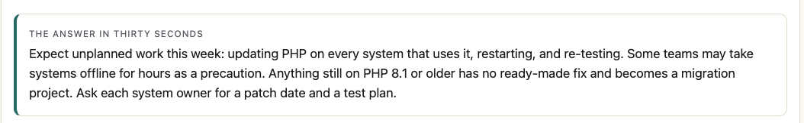

**WTF:** What is "The answer in thirty seconds", why is it here, and why do I need it? I only understood at the very end of the path that it is the answer to Taylor's question.

**Fix:** Label it as the answer to the question above, e.g. "The short answer to Taylor's question".

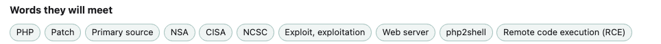

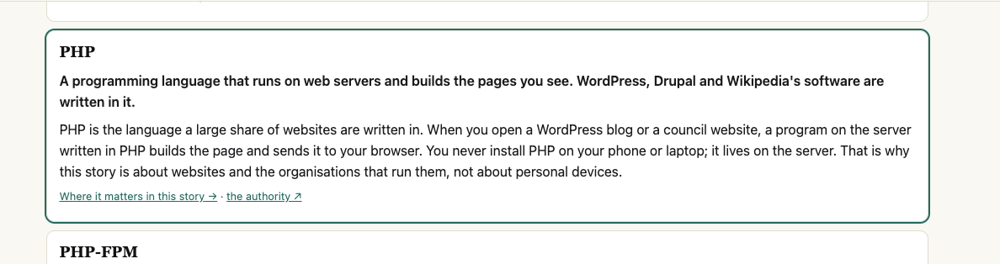

**What I think:** The reading path is helpful, and so are the minutes. The keywords are great: each opens a short definition (PHP: "A programming language that runs on web servers and builds the pages you see."), so I could learn the terms before reading.

### 6. Reading path, step 1: Taylor's briefing

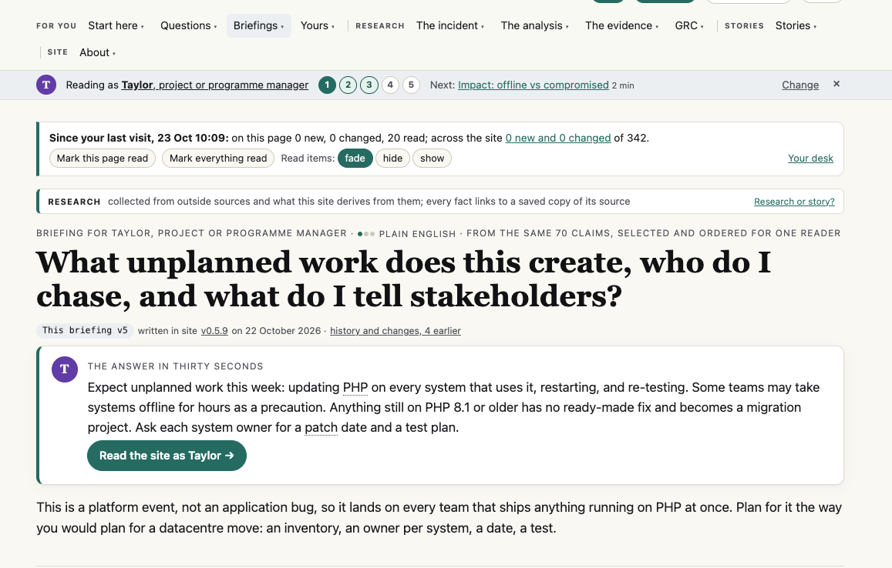

**What I see:** A bar: "Reading as Taylor, project or programme manager" with steps 1 to 5. Above the title: "FROM THE SAME 70 CLAIMS, SELECTED AND ORDERED FOR ONE READER". A second button, "Read the site as Taylor →". Lower down: "What to decide or do", then the reading path, "What this briefing covers", "What you can skip" and "Words you will meet" again. At the bottom: "The facts this rests on" ("Show the 20 claims behind this briefing, each with its status and sources") and "What is still open".

**What I think:** The progress bar is good: the current step is dark, opened steps are light green, the rest are white. The small print is useful but there is too much of it, and much repeats. I guess "What to decide or do" is what I must decide after reading.

**WTF:** What are the "70 claims", and why do I need to know?

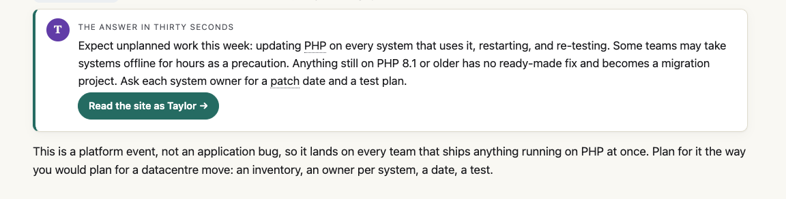

**WTF:** "Read the site as Taylor" took me straight to step 2. Does that mean I can skip the rest of step 1? A reader reads a page from top to bottom; jumping away suggests the rest doesn't matter.

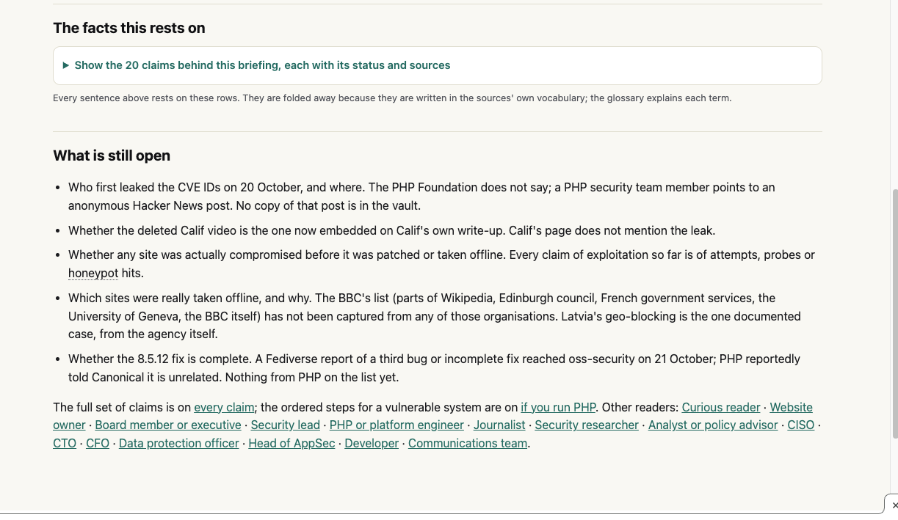

**WTF:** Why are "The facts this rests on" and "What is still open" here? I didn't understand what they were for.

### 7. Reading path, step 2: Explained from the start

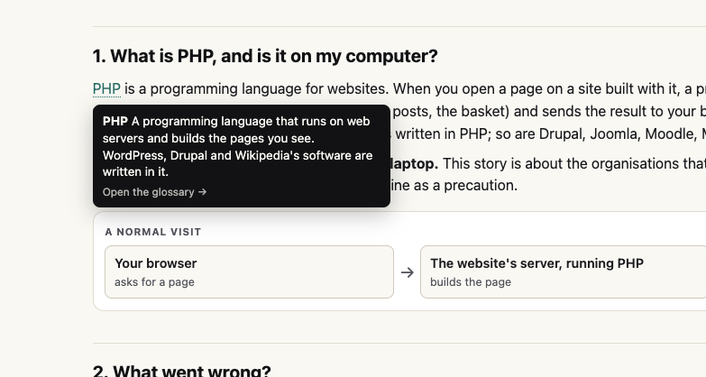

**What I see:** Hovering over "PHP" shows "A programming language that runs on web servers and builds the pages you see." and "Open the glossary →". Seven questions, starting with "1. What is PHP, and is it on my computer?". At the very end: "How to read this site: Every statement on this site carries one of five words, so you can tell a fact from a rumour at a glance:" CONFIRMED, REPORTED, DISPUTED, CONTRADICTED, UNVERIFIED.

**What I think:** The hover definitions are a big help for a non-technical project manager. The seven questions are the ones a PM would ask, and the answers fit what I wanted to know. Every sentence has a source I can open.

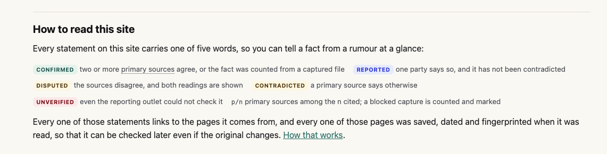

**WTF:** Why is "How to read this site" at the end, after I've already read it all? Once I read it I understood: it explains how far to trust each sentence and where it comes from. That's exactly what I needed before reading.

**Fix:** Move "How to read this site" to the top, or into step 1 of the reading path.

**Fix:** When I reach the bottom of a page there is no way to go on; I have to scroll back to the top to click 1 to 5. Add "Previous / Next" at the bottom of every page in the path.

### 8. The progress bar's "Next"

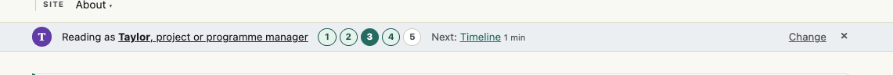

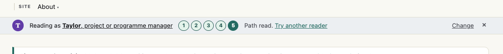

**What I see:** On step 3: "Next: Timeline 1 min". Clicking it took me to step 5, not step 4. On step 5: "Path read. Try another reader". Earlier, on step 1, it said "Next: Impact: offline vs compromised" (step 4).

**What I think:** "Next" points to the step after the furthest page I have *opened*, not the one after the page I'm on. Opening a page isn't reading it. If I click through 1 to 5 first and then go back to read properly, it says "Path read" and there is no Next at all. It felt like a bug.

**Fix:** "Next" should always go to the next numbered step. If it is meant to skip pages, say so: "Next unread: 5. Timeline".

### 9. Reading path, step 3: If you run PHP

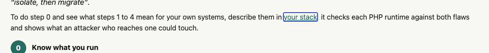

**What I see:** "To do step 0 and see what steps 1 to 4 mean for your own systems, describe them in your stack…". Steps from "0. Know what you run" onwards. The last section, "Pulling the plug, as a capability", including "the decision belongs to a named person and the execution belongs to a rehearsed runbook", and links to "the two flaws", "affected systems" and "the agencies".

**What I think:** The steps are simple and easy to follow. The links at the end are good: I can jump straight to what the text refers to.

**WTF:** From the words alone I thought "your stack" would move this content into my own systems. When I opened it, it looked complicated, like something I'd need to be taught. I left it.

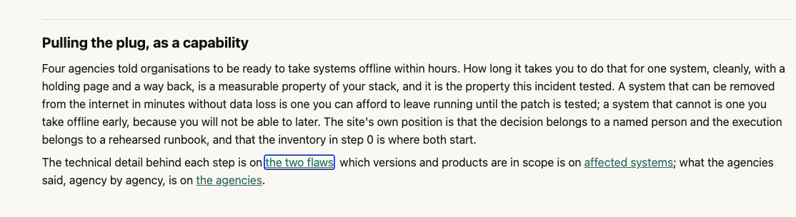

**WTF:** The title "Pulling the plug, as a capability" doesn't say what the section is or why it's there. After reading, it's actually the most useful conclusion for a PM: name who decides, and have a rehearsed plan.

**Fix:** A plain title, e.g. "What this means for you: who decides, and how fast you can go offline".

### 10. Reading path, step 4: Impact

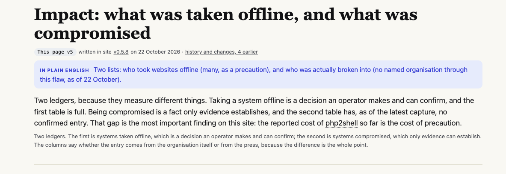

**What I see:** A blue box, "IN PLAIN ENGLISH: Two lists: who took websites offline…", then a paragraph starting "Two ledgers, because they measure different things.", then small print starting "Two ledgers. The first is systems taken offline…". Then the "Taken offline" and "Compromised" tables, each with "STATUS" and "SOURCES". Then "What the two ledgers say together", with points such as "Attempts are not compromises." and "Absence of evidence is weak here."

**WTF:** Are the big "Two ledgers" text and the small "Two ledgers" text repeating each other or adding something? Mostly repeating. With the blue box, the same point is made three times. The small print adds only one new thing: that a column says whether the entry comes from the organisation itself or from the press.

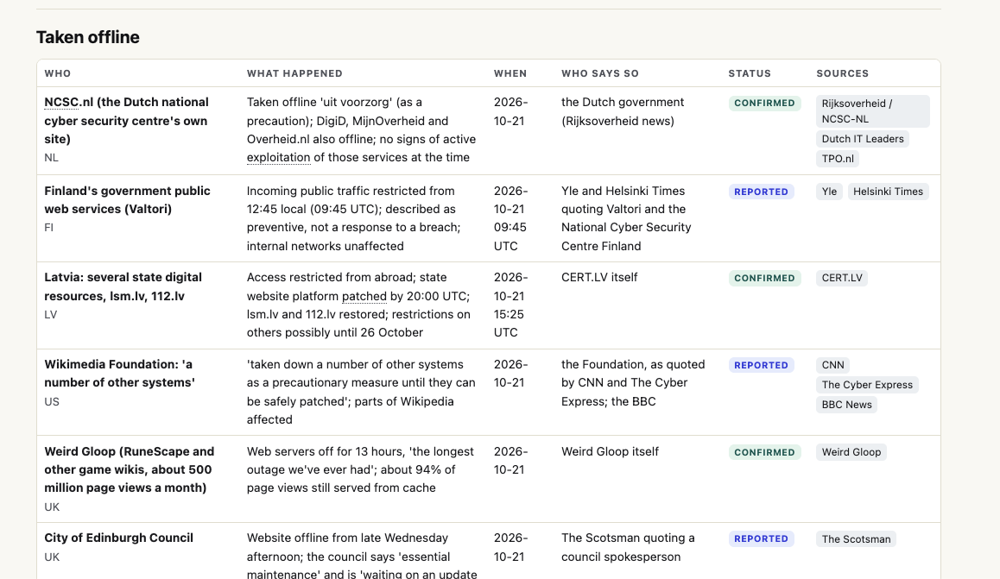

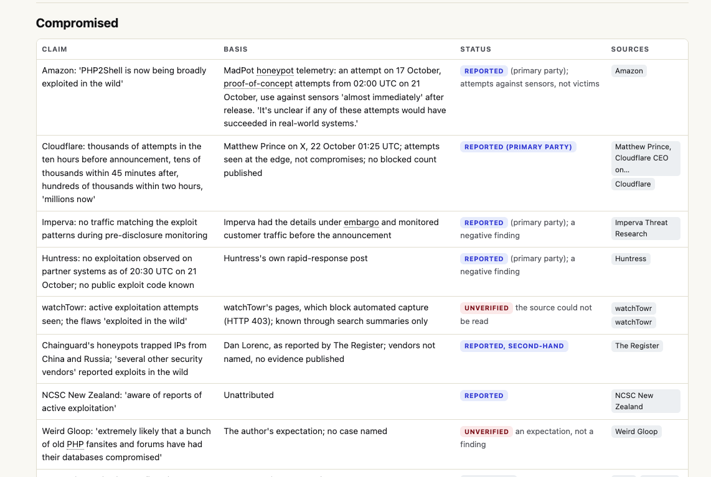

**What I think:** The two tables are clear, and the status and sources columns show how reliable each line is.

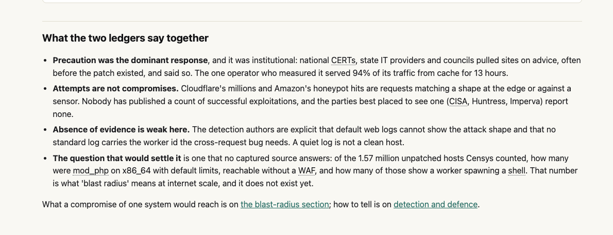

**WTF:** What is "What the two ledgers say together" saying? I needed it explained. It uses words like mod_php, x86_64, WAF, worker and shell.

**Fix:** Keep the blue box and the main paragraph; move the one new sentence next to the table and drop the rest. Open "What the two ledgers say together" with one plain sentence, like the blue box, e.g. "So far the cost is websites taken offline as a precaution; no one has confirmed a break-in, but quiet logs don't prove there wasn't one."

### 11. Reading path, step 5: Timeline

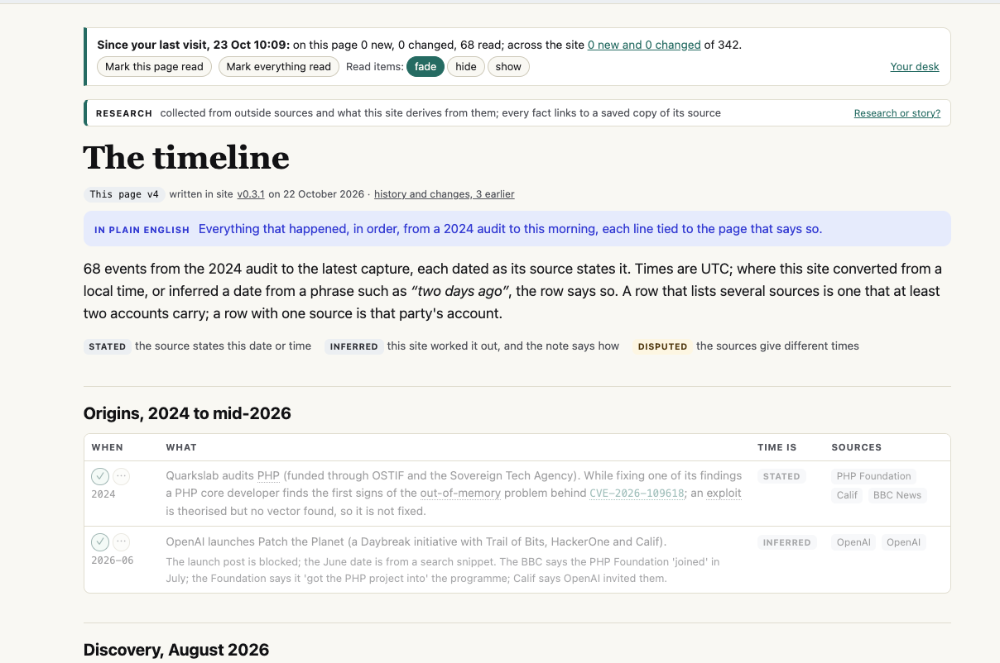

**What I see:** "Everything that happened, in order, from a 2024 audit to this morning, each line tied to the page that says so." Each row has a ✓ and a "⋯" button. "⋯" opens: "Done", "Read later", "Follow up", "Not for me", "More like this", "Liked", "Wrong", "Fix this", "Idea", a box ("A note, a correction, an idea. Kept in this browser."), "Keep the note", and at the bottom "Nothing leaves this browser. Your desk lists every note and decision, and exports them."

**What I think:** A good overview of how the story developed. The rows were greyed out again until I hovered over them (the page says "68 read", and the timeline has 68 events).

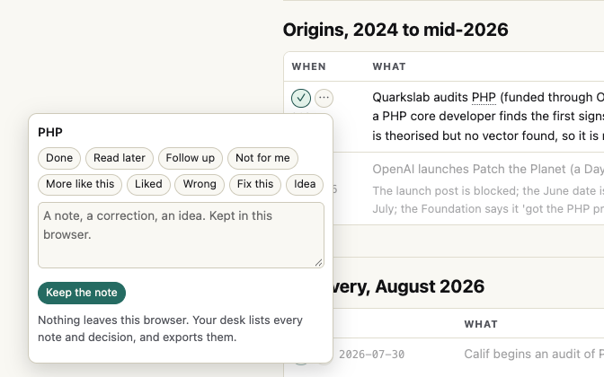

**WTF:** Is the "⋯" pop-up for my own notes, or does it go to the agents or the editor? The answer is in the small print at the bottom, but "Wrong", "Fix this" and "Idea" sound like reports to the team.

**Fix:** Put "Nothing leaves this browser" at the top of the pop-up, and add "Want the team to see this? Send it as feedback", linked to the Feedback button.

### 12. The fact-check desk

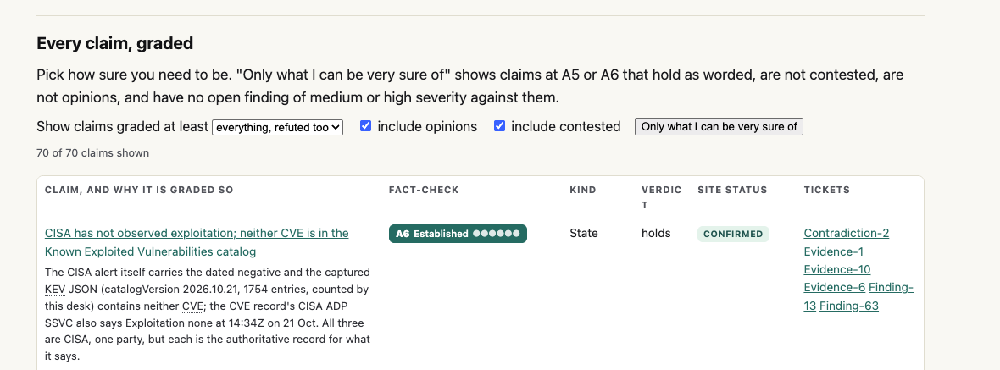

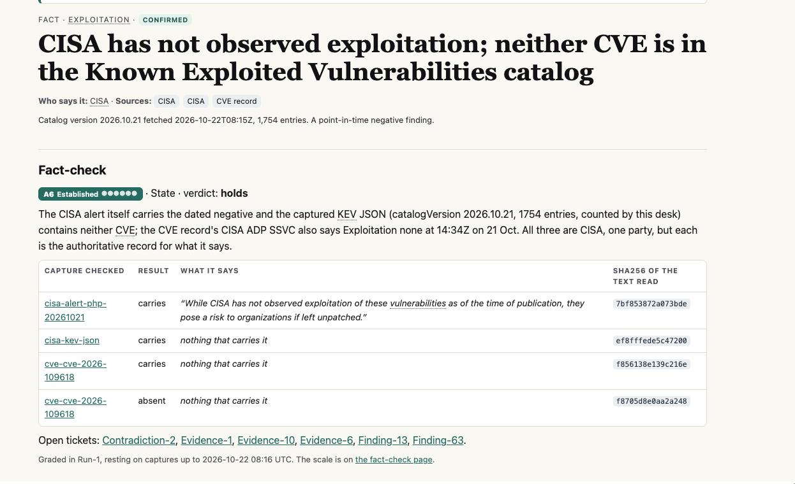

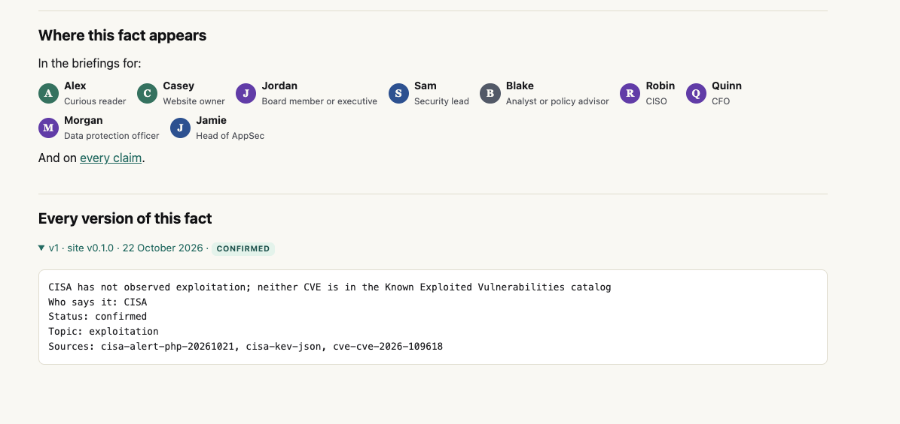

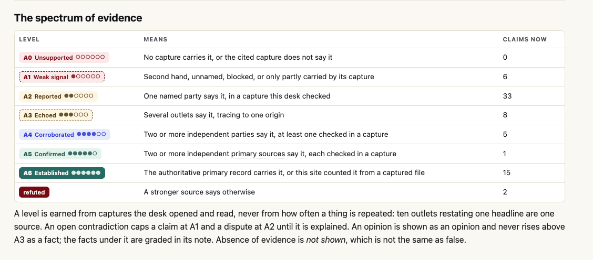

**What I see:** I picked the first claim: "CISA has not observed exploitation; neither CVE is in the Known Exploited Vulnerabilities catalog", "A6 Established", site status "CONFIRMED". Its page has "Who says it: CISA · Sources: CISA CISA CVE record", "This fact over time", "What it rests on", "Where this fact appears", "Every version of this fact", and "Open tickets: Contradiction-2, Evidence-1, Evidence-10, Evidence-6, Finding-13, Finding-63". Contradiction-2 is "K-002: Is php2shell being exploited?", "medium", "EXPLAINED". At the bottom: "The scale is on the fact-check page." On that page, "The spectrum of evidence" explains A0 to A6.

**What I think:** The claim's page is simple to understand: who says it, then the sources. The version history makes it more trustworthy. I trust the A6 grade. The spectrum table is a good reference once you find it.

**WTF:** Does it link to the original web page? It does, but only one level down, on the site's own source page. At first I thought there was no link.

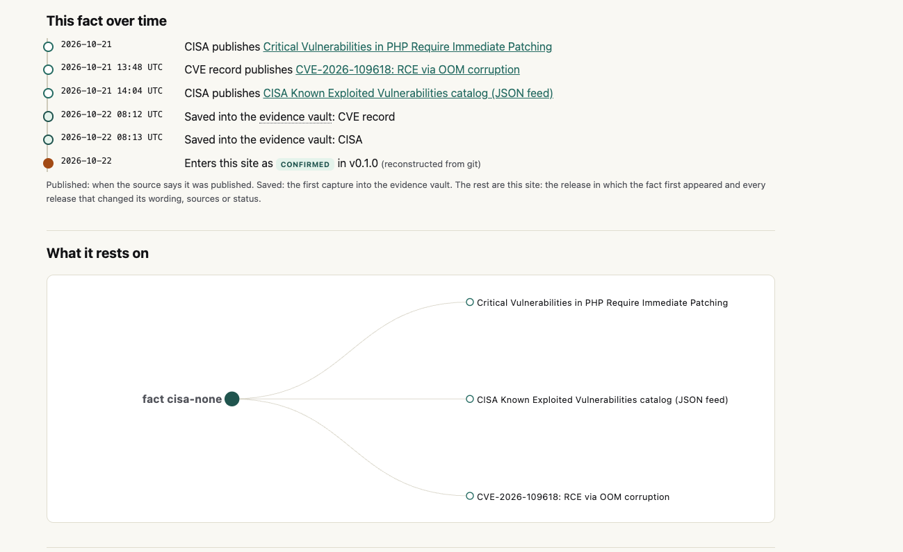

**WTF:** What is "What it rests on" for? It shows the same three sources as the list at the top, as a diagram.

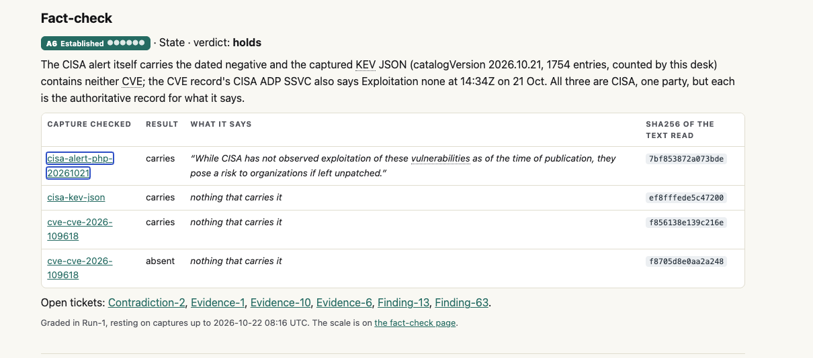

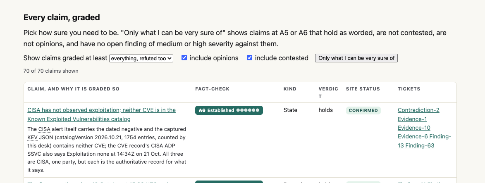

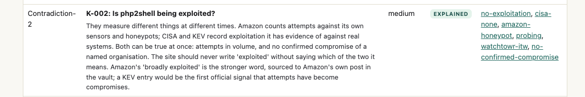

**WTF:** What are "Open tickets" and the "TICKETS" column? I clicked one and still didn't understand. Every ticket opens more links, which opens more links. It felt like information overload.

**Fix:** A direct link to the original next to each source ("Read the original on cisa.gov ↗"). Hide tickets from general readers, or rename them "Fact-checkers' notes" with one line of explanation. Put a hover definition on each grade label, linking to the full scale.

### 13. The team page

**What I see:** "2 people and 17 agents and roles", each with a page. Lower down: "One file per agent per concern. So a merge never asks a human to choose between two agents' edits." and "Write only in your own folder… To ask another member for work, send it mail; the owner opens the task." The Conductor "Maps the work, hands it out, and keeps every member, human and agent, synchronised."

**What I think:** It's clear who is a person and who is an agent, and what each does. There are a lot of agents and a lot of information. Would I want an agent team like this? Yes. My questions: when one agent depends on another's work, do they clash? Are there delays? Does a person need to step in and push? The page does answer most of this, but lower down, in the agents' working rules and in their language (vault, lane, check-in cycle), so I missed it the first time.

**Fix:** A short plain paragraph near the top, e.g. "How do the agents avoid clashing? Each owns its own files, asks others for work by message, and a conductor plans every run and tracks who is waiting on whom. Dinis decides; Vicky tracks what's late."

### 14. How the site is organised

**What I see:** The breadcrumb at the top: "newsroom / 2026 / October / PHP".

**What I think:** Only after going back up a level did I realise this is October 2026's story, that everything is on this site, and that I can read it straight through or through a reader's eyes. Taylor's briefing says "FROM THE SAME 70 CLAIMS…" but never explains it plainly.

**Fix:** One line at the top of Power users: start here, e.g. "This site follows one story for one month, October 2026's PHP security flaws. Read it straight through, or pick a reader and see it through their eyes." And on Taylor's briefing: "Every reader sees the same 70 facts; this briefing picks the 20 a project manager needs, in the order you need them."

Also seen in the reference test: the one-line description of the site is only in the footer.

## Ask 001: my answers

1. **Which reader, and was the question answered:** Taylor, project or programme manager. Mostly. "What unplanned work" and "who do I chase" are answered clearly in "The answer in thirty seconds" and "What to decide or do". "What do I tell stakeholders" is only half answered: it says to agree with stakeholders who can make the downtime call, but gives me nothing I could send. I only realised at the end that "The answer in thirty seconds" was the answer to Taylor's question.
2. **What I expected and could not find:** Nothing in particular; I'm new to this, so I did what the pages told me. What I kept looking for was explanations: what "DEVELOPING" means, why parts of pages go grey, what tickets are, what the grades are based on, and how the site is organised.
3. **What would bring me back on Monday:** A short status update I could send straight to stakeholders, kept current. That's the part of Taylor's question the site doesn't answer yet.
4. **One thing to remove, one to add:** Remove the repetition and the complicated wording for simple things. It isn't one thing; it's a pattern across the site (examples under Top changes). Add "Previous / Next" buttons at the bottom of every page in the reading path, so I don't have to scroll back to the top.

## Contradictions between pages

| Page A says | Page B says | Why it matters |
|-------------|-------------|----------------|
| "How to read this site": "Every statement on this site carries one of five words" (CONFIRMED, REPORTED, DISPUTED, CONTRADICTED, UNVERIFIED). CONFIRMED: "two or more primary sources agree, or the fact was counted from a captured file". | The fact-check desk grades every claim from A0 to A6. "A5 Confirmed": "Two or more independent primary sources say it, each checked in a capture". | One claim shows two labels from two scales ("A6 Established" and "CONFIRMED"), and "Confirmed" has a different bar in each. A newcomer can't tell which to go by. |
| The "⋯" pop-up offers "Wrong", "Fix this" and "Idea". | The same pop-up: "Nothing leaves this browser." | A reader who presses "Wrong" thinks they've reported an error. The team never sees it. |
| A claim graded "A6 Established", status "CONFIRMED", lists "Open tickets: Contradiction-2…" | Contradiction-2's status is "EXPLAINED". | "Open" sounds unresolved, next to a claim the site calls established. |
| The progress bar numbers the steps 1 to 5. | "Next" goes to the step after the furthest one *opened*: "Next: Impact" (step 4) on step 1; "Next: Timeline" (step 5) on step 3; "Path read" with step 4 unread. | Opening a page isn't reading it. Clicking around first makes "Next" skip pages you haven't read. |

## What worked (keep this)

- "Start here: your first fifteen minutes": clear and easy to follow.
- "Right now" with "As of 22 October 2026, 11:34 UTC…": I know how fresh the news is.
- The reader map: rows and columns explained, easy to pick a reader.
- The reading path with minutes per page, and the progress bar's colours.
- "Words they will meet" and the definitions on hover: a big help for a non-technical reader.
- The seven questions in "Explained from the start": the questions a PM actually asks.
- Every sentence links to its source.
- "If you run PHP": steps 0 to 6 are simple to follow, and the links at the end go straight to the detail.
- Impact's two tables, with status and sources on every row.
- The timeline: a good overview of the whole story.
- The claim page: who says it, then the sources; the version history adds trust.
- "The spectrum of evidence": a clear reference for the grades.
- The team page: clear who is human, who is an agent, and what each does.

## What I could not do

- Now, on my phone: not done in this session.
- Your stack: I opened it, but it looked like it needs someone to teach me how to use it, so I didn't try it.

## Top changes, in order

1. Cut the repetition and the complicated wording. Examples: two grading scales for one claim; "Two ledgers" said three times on Impact; small print repeating the text above it; "Needs / Can skip" on Taylor's card and again as "What this briefing covers / What you can skip"; tickets and "What it rests on" shown to every reader.
2. Tell readers how to read the site before they read: move "How to read this site" to step 1, and label "The answer in thirty seconds" as the answer to the reader's question.
3. Add "Previous / Next" at the bottom of every page in the reading path, and make "Next" go to the next numbered step.
4. Use one grading scale, or say how the two match ("CONFIRMED means A5 or A6"), and put a hover definition on every grade label.
5. Explain the unexplained: "DEVELOPING", faded content (= already read), the "⋯" pop-up (= private notes, not feedback), tickets.
6. Give Taylor a short, ready-to-send update for stakeholders.
7. Put a direct link to the original next to each source.
8. Open the team page with a plain paragraph on how the agents avoid clashing and who decides.

[← All feedback](../)
