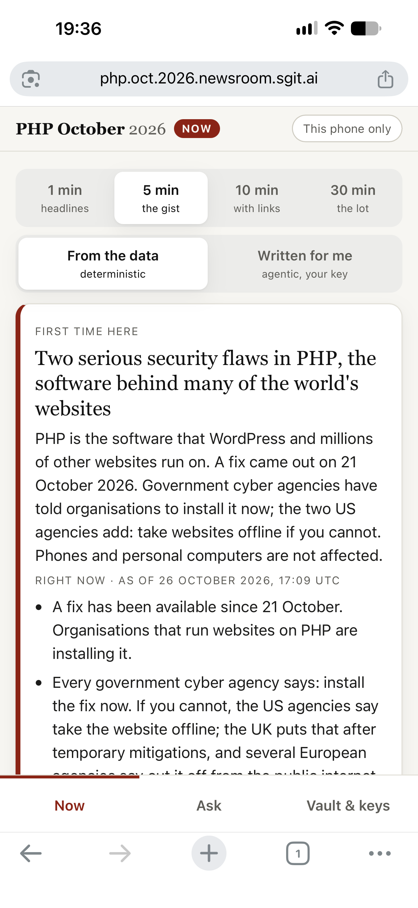
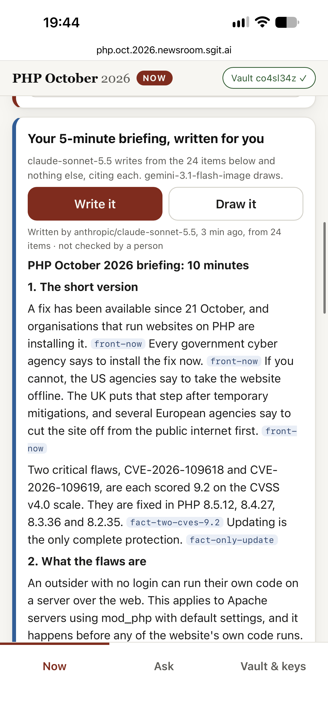
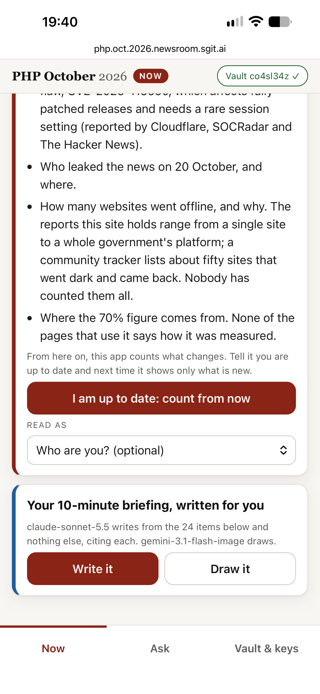
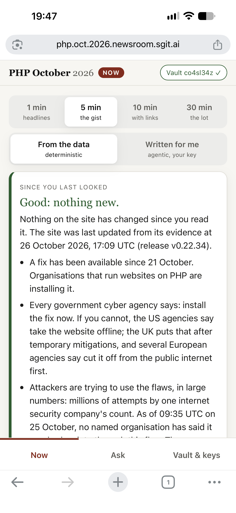
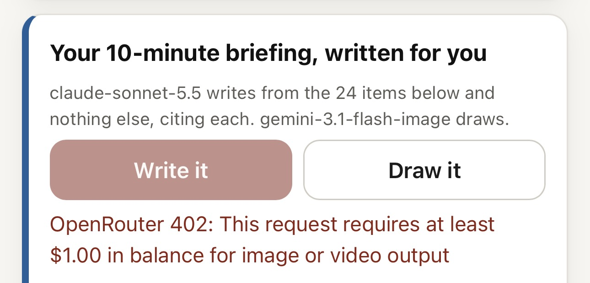
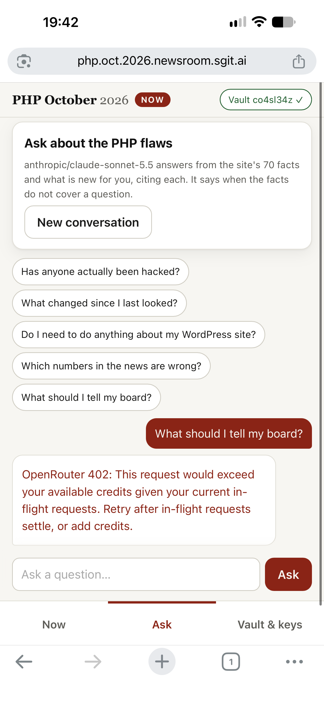

# PHP October 2026: the Now view on my phone

**Tester:** Vicky, as a power user

**Date:** 26 October 2026, about 19:30 to 19:50 Lisbon time · iPhone, Chrome · site v0.22.34

**Tested:** [php.oct.2026.newsroom.sgit.ai](https://php.oct.2026.newsroom.sgit.ai/) on a phone: the Now tab (reading time, "From the data" and "Written for me", "I am up to date", "Read as") and the Ask tab.

**Persona:** non-technical newcomer; knows AI assistants, has an OpenRouter key with little credit on it.

## The short version

The Now view on a phone is much simpler than the desktop page and easier to follow. Choosing how long to read, telling the site "I am up to date", and choosing who I am all worked well, and Ask lets each reader get an answer at their own level. Two things held me back: the page is text only, so it feels dry, and the parts written by an AI need the reader's own OpenRouter key with credit, which is a barrier, and when the credit runs out the page shows the provider's raw error.

## Step by step

### 1. First view: reading time and two modes

**What I see:** Four reading times (1 min headlines, 5 min the gist, 10 min with links, 30 min the lot), then two modes: "From the data, deterministic" and "Written for me, agentic, your key". Below that, "First time here" with the headline and plain bullet points.

**What I think:** Choosing how long I want to read is a clear and useful idea. The page is much calmer than the desktop version. But it is all text, so it feels a bit dry.

**Fix:** Bring in one or two visuals the desktop page already has, such as the status cards (Is there a fix? / Anyone confirmed hacked?) or a short timeline.

### 2. "Written for me"

**What I see:** When I select "Written for me", the page does not switch. I have to scroll past all the "From the data" content to reach "Your 5-minute briefing, written for you", with "Write it" and "Draw it" buttons.

**What I think:** I expected the page to show only what I selected. Having both on one page makes the two buttons look like they do nothing.

**Fix:** Show only the selected mode: "From the data" shows only the data content, "Written for me" shows only the written briefing.

### 3. "I am up to date" and "Read as"

**What I see:** At the end of the content: "From here on, this app counts what changes. Tell it you are up to date and next time it shows only what is new", a button "I am up to date: count from now", and "Read as: Who are you? (optional)".

**What I think:** I like both. "Read as" changes the content to suit the reader's role, so the wording is easier to understand. "I am up to date" lets me tell the site what I have already read.

### 4. Coming back: "Good: nothing new"

**What I see:** After tapping "I am up to date" and coming back, the page opens with "Since you last looked: Good: nothing new" and the time the site was last updated from its evidence.

**What I think:** This is a good way to tell a returning reader, in one line, whether anything changed. It worked as described.

### 5. "Draw it"

**What I see:** "OpenRouter 402: This request requires at least $1.00 in balance for image or video output".

**What I think:** Drawing needs paid credit on my own key, which is fair. But a newcomer will not understand this message, and I had no idea what the picture would look like before deciding whether to add credit.

**Fix:**
- Replace the raw error with a plain message, e.g. "Drawing needs an OpenRouter key with at least $1.00 of credit. How to set it up →".
- Show a sample picture next to "Draw it", so readers can see what they would get. That would likely make them more willing to pay for it.

### 6. Ask

**What I see:** "Ask about the PHP flaws", with suggested questions (Has anyone actually been hacked? / Do I need to do anything about my WordPress site? / What should I tell my board?). When I tapped "What should I tell my board?", the answer was "OpenRouter 402: This request would exceed your available credits given your current in-flight requests. Retry after in-flight requests settle, or add credits."

**What I think:** Ask is one of the most useful parts. Even when the content is written for a role, readers know different amounts about the topic, and Ask lets each person get an answer at their own level. The suggested questions are a good start. But it also needs credit on the reader's key, and the error is the provider's raw text.

**Fix:** Same as Draw it: a plain message that says what is needed and how to set it up.

## What worked

- Choosing a reading time (1, 5, 10 or 30 minutes).
- "I am up to date" and "Since you last looked: nothing new".
- "Read as", which adapts the wording to the reader.
- Ask, with suggested questions.
- On a phone, the Now view is far easier to read than the desktop page.

## Top changes, in order

1. Replace the OpenRouter error messages with plain ones that say what is needed and how to set it up.
2. Show only the selected mode ("From the data" or "Written for me").
3. Show a sample of what "Draw it" produces before asking readers to pay for it.
4. Add one or two visuals to the Now view, e.g. the status cards or a short timeline.

## Open question

- The OpenRouter key is the main barrier for a newcomer. Is there a plan for readers who do not have a key, for example a few free questions or written briefings?

[← All RiskMandate feedback](../)
