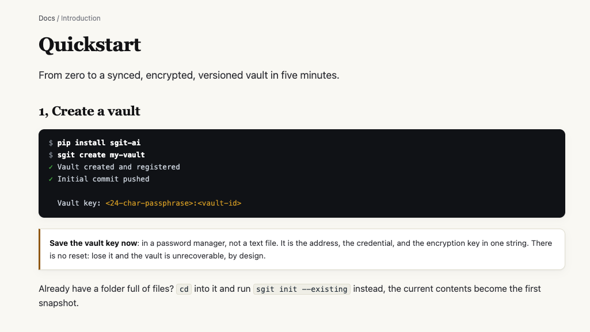
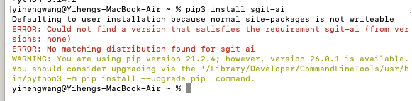
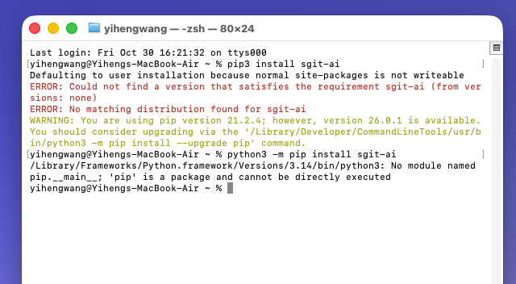
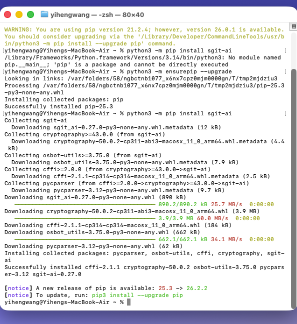
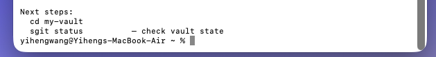
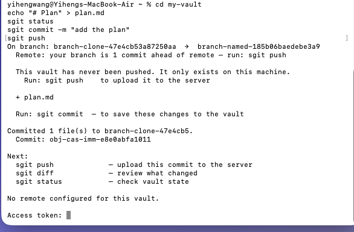
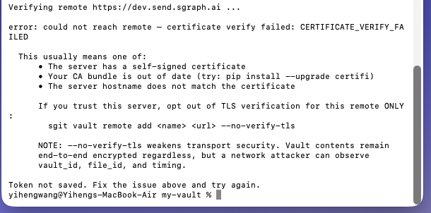
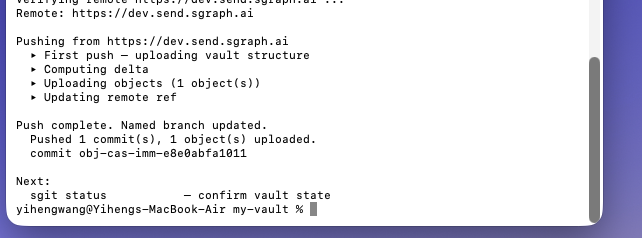
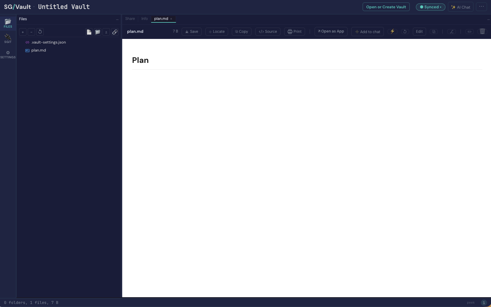
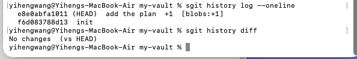

# sgit: following the Quickstart on my own Mac

**Tester:** Vicky, as a non-technical first-time user

**Date:** 30 October 2026, about 16:19 to 16:43 Lisbon time · MacBook Air, Terminal · sgit-ai 0.27.0

**Tested:** [sgit Quickstart](https://sgit.ai/docs/quickstart.html), steps 1, 2, 3 and 5. The terminal on the Try page did not work for me ([earlier task](../2026-10-30-sgit-try-in-browser/)), so I followed the Quickstart to install sgit on my own computer. My goal was still to create my own vault and push it.

## The short version

I got there: I created a vault, committed a file, pushed it, and opened it in the SG/Vault browser app. It took about 15 minutes and four errors. Three errors came from the Python set-up on my Mac, and one was an access token the page never mentions. I could not have solved any of them alone. I asked Claude to explain each one. Once sgit was installed, every sgit command worked first time, and its "Next steps" hints were the clearest guidance I met.

## Step by step

### 1. Reading the Quickstart

**What I see:** "From zero to a synced, encrypted, versioned vault in five minutes." Step 1 is a dark box with `pip install sgit-ai` and `sgit create my-vault`.

**What I think:** The page does not say where to type these commands. The dark box hints at a terminal, but only if you already know what a terminal looks like. If Claude had not told me, I would not have known to open Terminal at all. The page also does not say what I need first, such as which Python version.

**Fix:** Before step 1, tell me where to type the commands and how to open it, and what I need to have on my computer first.

### 2. First try: `pip3 install sgit-ai`

**What I see:** "ERROR: Could not find a version that satisfies the requirement sgit-ai", then "No matching distribution found for sgit-ai".

**What I think:** It reads as if sgit does not exist. I did not know how to continue, so I asked Claude. It explained that the command had used an old version of Python on my Mac, and sgit needs a newer one. So the problem was the version, not that sgit was missing. Nothing on the page told me which version I needed.

**Fix:** Say on the page what I need before installing, and give an install command that works on a normal Mac.

### 3. Second try: `python3 -m pip install sgit-ai`

**What I see:** "No module named pip.\_\_main\_\_; 'pip' is a package and cannot be directly executed".

**What I think:** Claude explained that this time a part of Python itself was broken, and gave me a command to repair it. By now I had two errors and had not used sgit itself yet. A new user cannot tell that this is a Python problem, not an sgit problem. They will just think "sgit will not install".

**Fix:** Add a short "If the install fails" section, with the common problems and what to do. Or offer an easier way to install.

### 4. Install works

**What I see:** After repairing pip, the install worked: "Successfully installed ... sgit-ai-0.27.0". At the end, pip suggests "To update, run: pip3 install --upgrade pip".

**What I think:** I was relieved it worked. I did not know whether to follow the update hint at the end. Claude said to ignore it, because it uses the same command that failed in step 2.

### 5. Creating the vault

**What I see:** `sgit create my-vault` worked first time. It printed the vault key (not in this screenshot, on purpose), then "Next steps: cd my-vault, sgit status".

**What I think:** This was the guidance I wanted from the start: what to do next, in order. I saved the vault key straight away, as the page says.

### 6. Commit, then push asks for an access token

**What I see:** I typed the five commands from steps 2 and 3 of the Quickstart. `sgit status` showed plan.md as new, and `sgit commit` saved it. Then `sgit push` said "No remote configured for this vault." and stopped at "Access token:".

**What I think:** The Quickstart never mentions an access token. I had just saved a vault key and was not sure if this was the same thing. I did have a token from Dinis, but while I was looking for it, the prompt timed out after 30 seconds and cancelled. Nothing told me there was a time limit.

The output also contradicts the page. The Quickstart says `sgit create` shows "Initial commit pushed". My status said "This vault has never been pushed. It only exists on this machine."

**Fix:**
- Say on the page that the first push needs an access token, what it is, and where to get one.
- Say that the vault key and the access token are two different things.
- Show the time limit at the prompt, or wait longer.
- Make the page match what `sgit create` actually prints.

### 7. Push again: certificate error

**What I see:** With the token pasted in time: "error: could not reach remote, certificate verify failed", then "Token not saved". The message lists three possible causes, and one option is to turn off a security check.

**What I think:** I could not understand the three causes. Claude explained that Python on my Mac needed one extra set-up step, and told me how to run it. That fixed the error. I would not have found it myself. I was also uneasy that the message offers to turn off a security check. For a product built on security, that is the easiest line for me to copy, and it felt like the wrong one.

**Fix:** Tell me in plain words what to do next, and do not suggest turning off security as an easy way out.

### 8. Push works

**What I see:** "Push complete. Named branch updated. Pushed 1 commit(s), 1 object(s) uploaded." Each stage is listed as it runs.

**What I think:** Clear. I could follow what it was doing, and it ended with a next step again.

### 9. Opening the vault in the browser

**What I see:** `sgit vault info` printed a web link. It opened my vault in SG/Vault: plan.md on the left, "Plan" on the right, and "Synced" at the top. The link and the terminal output contain the vault key, so I only captured the page.

**What I think:** This was the moment it made sense. A file I made in the terminal was right there in the browser. One small question: the title says "Untitled Vault", but I named it my-vault.

### 10. Looking around (step 5)

**What I see:** `sgit history log --oneline` lists two versions, "init" and "add the plan". `sgit history diff` says "No changes (vs HEAD)".

**What I think:** The log is easy to read. The diff confused me. The page says it shows "what changed", so I expected to see my plan.md. Claude explained that it only shows changes I have not saved yet, and I had just saved.

## What I did not do yet

- **Step 4, clone somewhere else.** The page says "on another machine, or in an agent's session", but not how to do it with an agent. Claude tried from its own cloud session: sgit installed, but the session could not reach the sgit server. I will try this later. Claude also told me an agent should get a read-only key, not my vault key, but the page does not say this or how to get one.

## What worked

- Every sgit command worked first time: create, status, commit, push, vault info, history.
- The "Next steps" hints after each command.
- Push shows each stage as it runs.
- Seeing my file in the browser app straight after pushing.

## Top changes, in order

1. Explain the access token on the page: what it is, how it is different from the vault key, and where to get one.
2. Add a "Before you start" section: where to type the commands, how to open it, and what I need on my computer first.
3. Make installing easier for someone like me, or add an "If the install fails" section. Three of my four errors happened before I could use sgit at all.
4. When something goes wrong, say what to do next in plain words, and do not offer turning off security as the easy way out.
5. Make the page match what I actually see, and tell me when a prompt will time out.
6. Explain how to let an AI agent use my vault safely.

## Open question

- Where should a new user get an access token: sign up somewhere, or ask the team?

[← All RiskMandate feedback](../)
