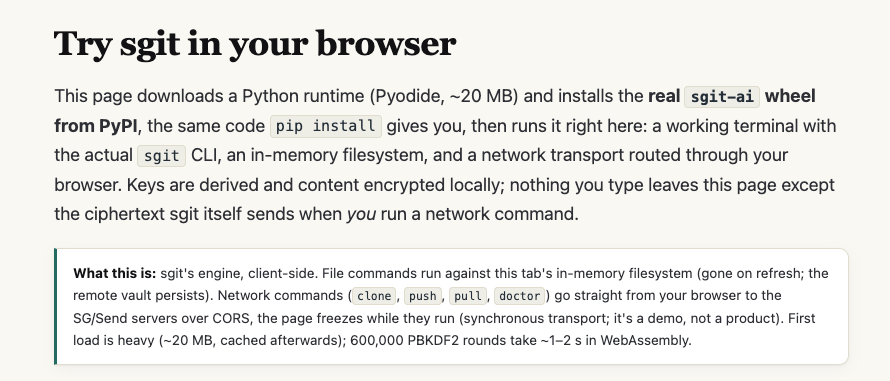
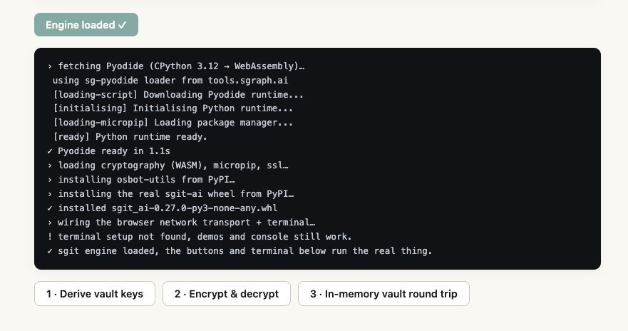
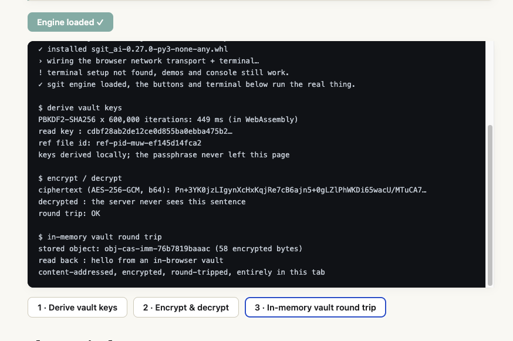
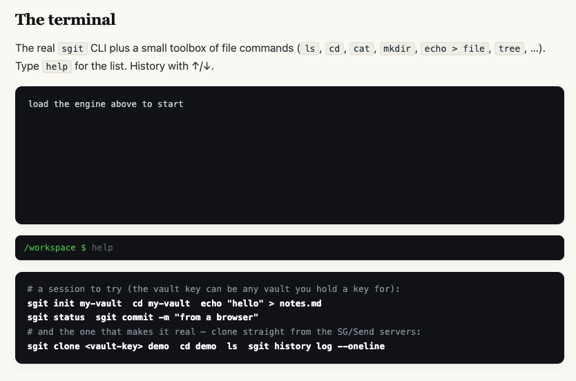
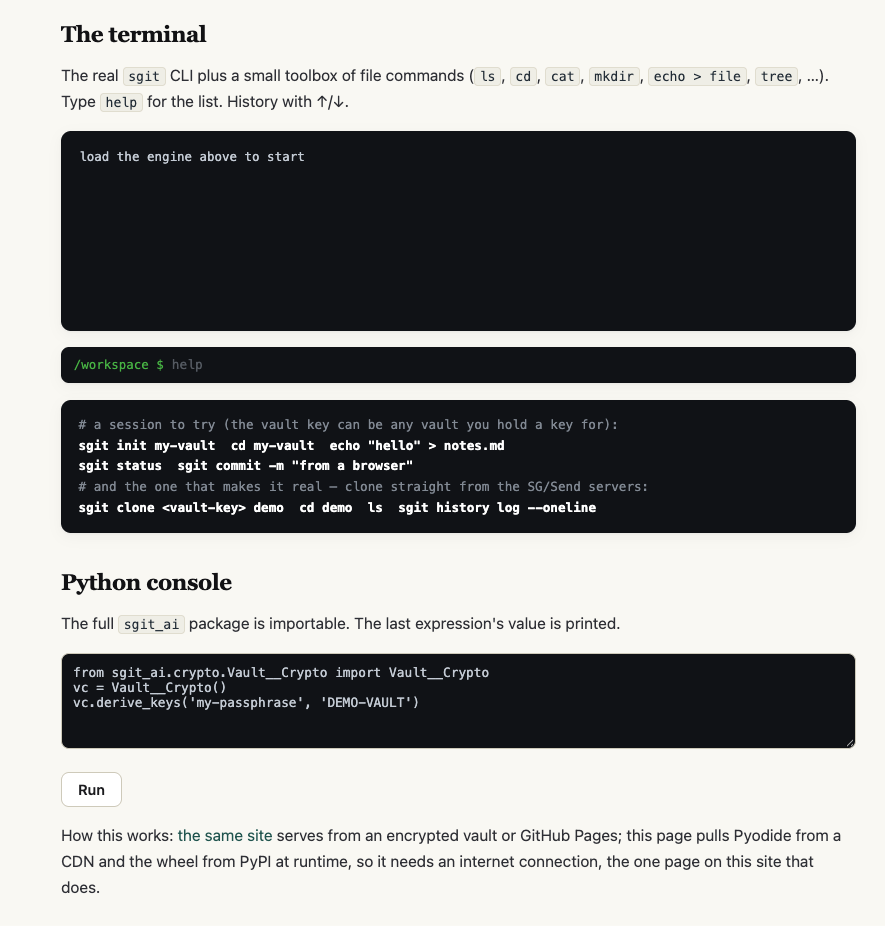

# sgit: trying it in the browser for the first time

**Tester:** Vicky, as a non-technical first-time user

**Date:** 30 October 2026, about 13:40 to 14:10 Lisbon time · Mac, Chrome · site v0.7.87

**Tested:** [Try sgit in your browser](https://sgit.ai/try/index.html), reached from the sgit.ai home page → Docs menu → Try it in the browser. My goal was to create my own vault and push it.

## The short version

The three demo buttons were easy: click 1, 2, 3 and each one runs. But I could not create my own vault. The page opens with technical text instead of steps, and the terminal below the demos never connected. It kept saying "load the engine above to start" after the engine had loaded, and the same happened after a refresh. I got stuck there and asked Claude for help.

## Step by step

### 1. Opening the page

**What I see:** Two paragraphs of technical text: Pyodide, the PyPI wheel, an in-memory filesystem, CORS, PBKDF2, WebAssembly.

**What I think:** I expected something simple, like "Step 1, Step 2, Step 3". I could follow some of it, but I had to slow down and read carefully. After reading, I still did not know what to do first.

**Fix:** Open with a few short steps. Move the technical detail lower down. Keep the practical notes: the first load is about 20 MB, a refresh clears everything, and the page freezes briefly during network commands.

### 2. Loading the engine and the demo buttons

**What I see:** The engine loaded in about one second. I clicked buttons 1, 2 and 3 in order, and each one ran and showed a result. The log also has this line: "! terminal setup not found, demos and console still work."

**What I think:** This part was easy. It was the step-by-step experience I had hoped for at the top of the page. Two things I did not understand:
- The output is all technical terms (PBKDF2, ciphertext, obj-cas-imm). I could see that each step worked, but not what it showed me.
- I did not notice the "terminal setup not found" line at first. Later it turned out to matter.

**Fix:**
- At the top of the page, say "Scroll down and click 1, 2, 3 in order".
- Add one plain sentence under each button, e.g. "Step 2: this sentence is encrypted. The server only ever sees the scrambled version."

### 3. The terminal: where I got stuck

**What I see:** The terminal box says "load the engine above to start". The section above already says "Engine loaded ✓", and the demo buttons worked.

**What I think:** The two messages did not match, and I did not know what to do. I got stuck here, so I asked Claude for help. It explained that the warning in the log meant the engine had loaded but the terminal had not connected, so this was not a mistake on my side. It also explained the example commands in plain words: create a vault, go into it, add a file, check the changes, save a version.

Looking back, three things made this step harder:
- The warning was in the log at the top, and the stuck terminal was further down. I could not connect the two.
- The example commands do not say where to type them, or whether to type one line at a time.
- "help" in the input line is grey. It looked already filled in, so I was not sure if I should type it myself.

**Fix:**
- When the terminal fails to load, say so in the terminal itself, e.g. "The terminal did not load. Refresh the page and try again."
- Add one line above the example commands: "Type each line in the box above and press Enter."

### 4. Trying again after a refresh

**What I see:** The refresh cleared everything, so I started again: load the engine, click 1, 2, 3. The terminal still said "load the engine above to start". I could not click into the terminal input line, so I could not type "help". The only place I could type was the Python console. I clicked Run there with the example code, and nothing happened.

**What I think:** The page did say that files are lost on refresh, but I had not understood that this meant all the results too. In the end, the demo buttons were the only part that worked for me, so I could not create my own vault in the browser.

**Fix:** Fix the terminal. Until then, say on the page that it is not working and point to the [Quickstart](https://sgit.ai/docs/quickstart.html) as the way to try sgit.

## What worked

- The three demo buttons, numbered 1, 2, 3, each with a visible result.
- The engine loaded quickly, in about one second.

## Top changes, in order

1. Fix the terminal, or say on the page that it is not working and point to the Quickstart.
2. When the terminal fails, show a clear message in the terminal, not only a line in the log.
3. Open the page with a few short steps, including "Scroll down and click 1, 2, 3".
4. Add one plain sentence under each demo button saying what it shows.
5. Say where and how to type the example commands.

## Next

I will try the [Quickstart](https://sgit.ai/docs/quickstart.html) next, to install sgit on my own computer, and write about it in a separate task.

[← All RiskMandate feedback](../)
